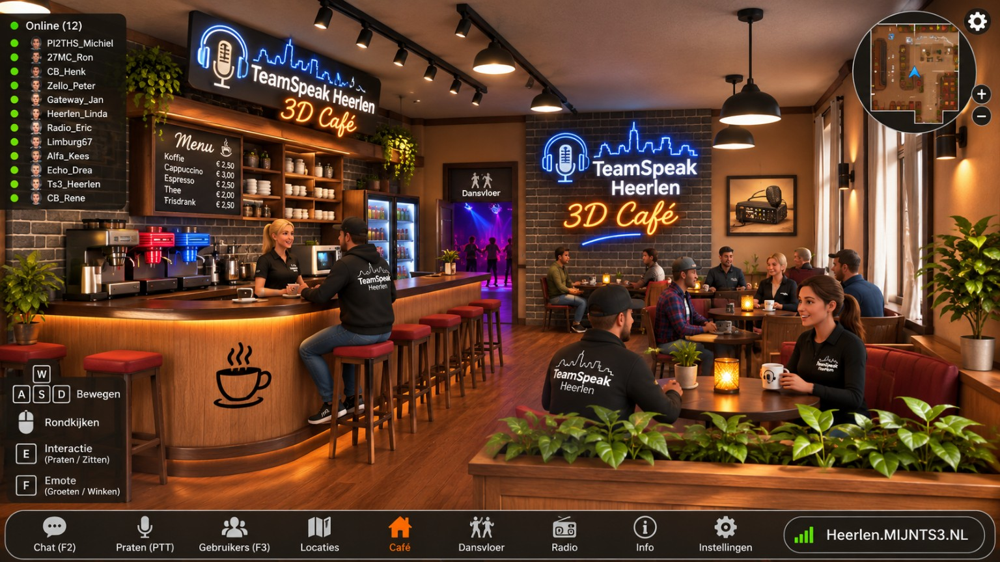

# ☕ TeamSpeak Heerlen – 3D Café



Een **Godot 4.7.2**-prototype van een virtueel 3D-koffiehuis voor Windows. De afbeelding hierboven is de **referentie/look**, geen screenshot van de huidige 3D-app. De ruimte in het project is opgebouwd uit echte 3D-objecten, zodat je er kunt rondlopen.

**TeamSpeak-server:** `Heerlen.MIJNTS3.NL`

> **Versie 0.1: lokaal prototype.** Je kunt rondlopen, de camera draaien, een stoel gebruiken, dansen, naar de radiohoek gaan en TeamSpeak openen. Multiplayer, daadwerkelijke TeamSpeak-spraak in het spel, een live gebruikerslijst en automatisch 3D-positieaudio zijn **nog niet gebouwd**. De 6 aanwezige demo-avatars zijn **geen online gebruikers**.

## ✅ Wat zit er al in?

- Zelf opgebouwd 3D-koffiehuis met houten vloer, bakstenen wand, grote ramen en sfeerverlichting.
- Koffiebar met koffiezetapparaten, barkrukken en schappen.
- Tafels, stoelen, zithoek, kamerplanten en decoratieve verlichting.
- Dansvloer met gekleurde vloertegels en decoratieve avatars.
- Radiohoek met 27MC-thema.
- Bestuurbare third-person avatar, rondkijken en zit/interactieknop.
- Nederlandstalige HUD: minikaart, navigatie, gebruikersinfo, instellingen.
- Eigen gebruikersnaam lokaal bewaren in `user://cafe_profiel.cfg`.
- TeamSpeak-knop opent de normale TeamSpeak-client via `ts3server://Heerlen.MIJNTS3.NL` (indien ondersteund door Windows/TeamSpeak).
- GitHub Actions-workflow om automatisch een Windows `.exe` te bouwen.

## 🕹 Besturing

| Toets | Actie |
|---|---|
| `W A S D` | Lopen |
| Rechtermuisknop ingedrukt + muis | Camera draaien |
| Muiswiel | Zoom |
| `E` | Gaan zitten / opstaan bij een stoel |
| `F` | Dansbeweging aan/uit |
| `R` | Naar de ingang |
| `F2` | Lokale notities (nog geen echte chat) |
| Knop `Café`, `Dansvloer`, `Radio` | Verplaatsen binnen het café |
| `Verbind met TeamSpeak` | TeamSpeak 3 openen |

## 💻 Starten op Windows

1. Download [Godot 4.7.2 voor Windows](https://godotengine.org/download/windows/) (de standaardversie, niet .NET).
2. Pak dit project uit in een map, bijvoorbeeld `C:\TS-Heerlen-3D-Cafe`.
3. Start Godot en klik op **Importeren**. Selecteer `project.godot` in die map.
4. Open het project en druk op **F6** of **F5** om de hoofdscène te starten.
5. Voor spraak installeer je **TeamSpeak 3** op je Windows-computer, verbind met `Heerlen.MIJNTS3.NL` en stel push-to-talk in binnen TeamSpeak.

De Godot-app kan zonder extra 3D-server **op één pc** draaien. Dat betekent niet dat meerdere pc's elkaar al kunnen zien.

## 📦 Windows `.exe` uit GitHub bouwen

Na het uploaden van alle bestanden naar GitHub:

1. Open de repository en ga naar **Actions**.
2. Kies **Build Windows EXE** en klik op **Run workflow**.
3. Open de voltooide workflow-run en download het artifact `TS-Heerlen-3D-Cafe-Windows`.
4. Pak de ZIP uit, start de `.exe` in Windows.

De workflow gebruikt Godot 4.7.2 met export templates. Er wordt geen `.exe` gecommit naar de GitHub-broncode.

## 🧩 Projectindeling

```text
TS-Heerlen-3D-Cafe/
├── project.godot                  Godot hoofdproject
├── export_presets.cfg            Windows exportinstellingen
├── scenes/main.tscn              Hoofdscène
├── scripts/
│   ├── main.gd                   Camera, acties, TeamSpeak-startknop
│   ├── world.gd                  Café, bar, stoelen, dansvloer, verlichting
│   ├── avatar.gd                 Avatar, bewegen, zitten, dansen
│   ├── hud.gd                    Gebruikersinterface
│   └── minimap.gd                Minikaart
├── assets/textures/             Lokale, nieuw gemaakte texturen
├── docs/voorbeeld-layout.png    Door gebruiker gekozen ontwerpbeeld
└── .github/workflows/windows.yml
```

## 🎤 Hoe zit het met TeamSpeak en multiplayer?

TeamSpeak 3 transporteert **spraak**, maar verstuurt niet vanzelf 3D-posities naar Godot. Dit prototype start de normale TeamSpeak 3-client, maar bevat nog **geen** `.dll`-plugin en toont geen live TeamSpeak-data.

Als we daarna **zonder een aparte 3D-server** willen bouwen, kunnen we experimenteel de TeamSpeak 3 Client Plugin SDK gebruiken voor kleine avatarpositie-berichten tussen plugin-gebruikers in hetzelfde TeamSpeak-kanaal. Dat moet getest worden met twee Windows-computers en de server-floodlimieten; het is niet gegarandeerd voldoende voor vloeiend multiplayer. Zie [TEAM SPEAK INTEGRATIE](docs/TEAMSPEAK-INTEGRATIE.md).

## 📜 Licenties

De projectcode en de gegenereerde textures vallen onder MIT (`LICENSE`). De illustratie in `docs/voorbeeld-layout.png` is als door de gebruiker aangeleverde ontwerp-referentie opgenomen. De afbeelding is **geen vrij te hergebruiken 3D-model**. De TeamSpeak-naam en -merken zijn van hun respectievelijke rechthebbenden. Dit communityproject is niet officieel aangesloten bij TeamSpeak Systems.

## 🧪 Status

Het project is als broncode geleverd. Het is in deze omgeving **niet met de Godot-editor opgestart of op Windows getest**; voer de eerste import en build uit in Godot of via de GitHub Actions-workflow. Problemen kunnen worden gemeld via GitHub Issues.
